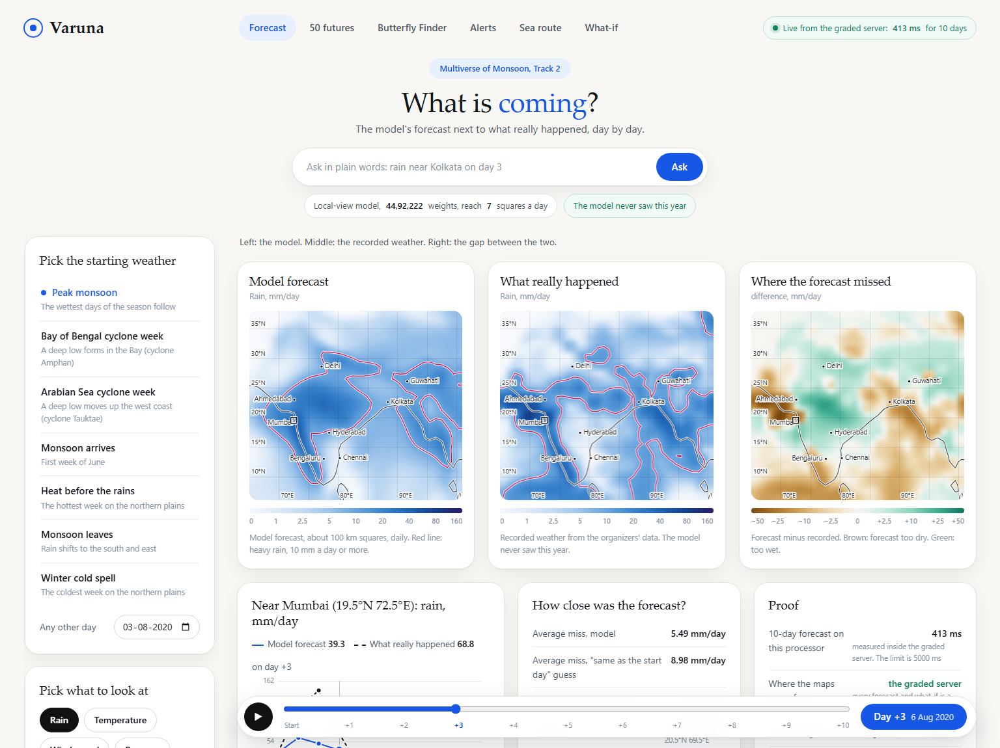
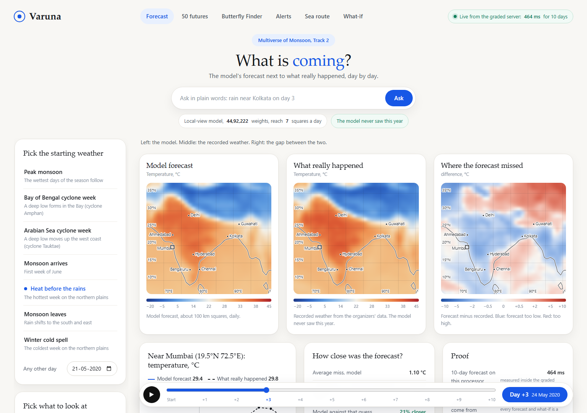
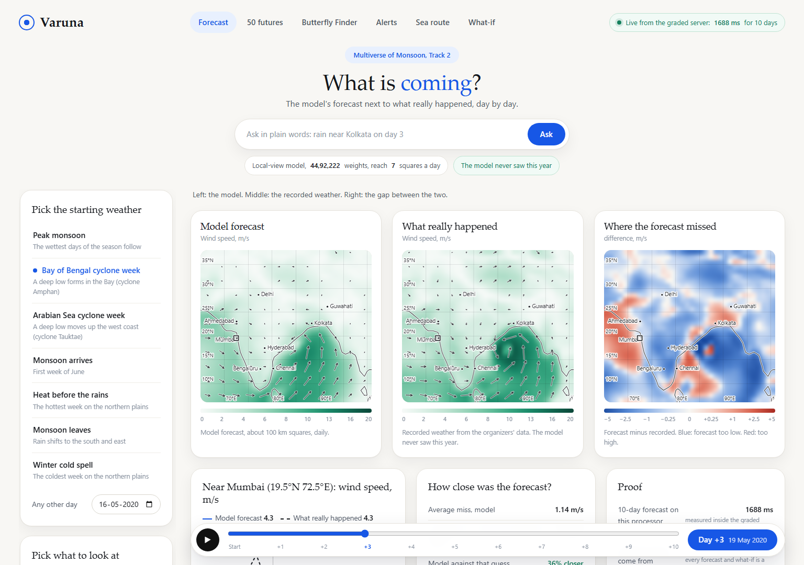
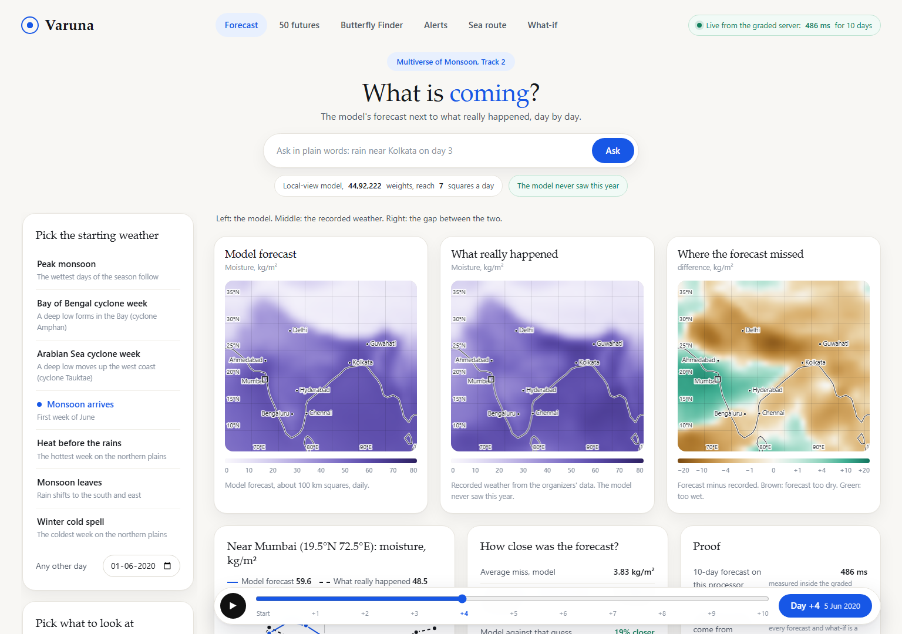
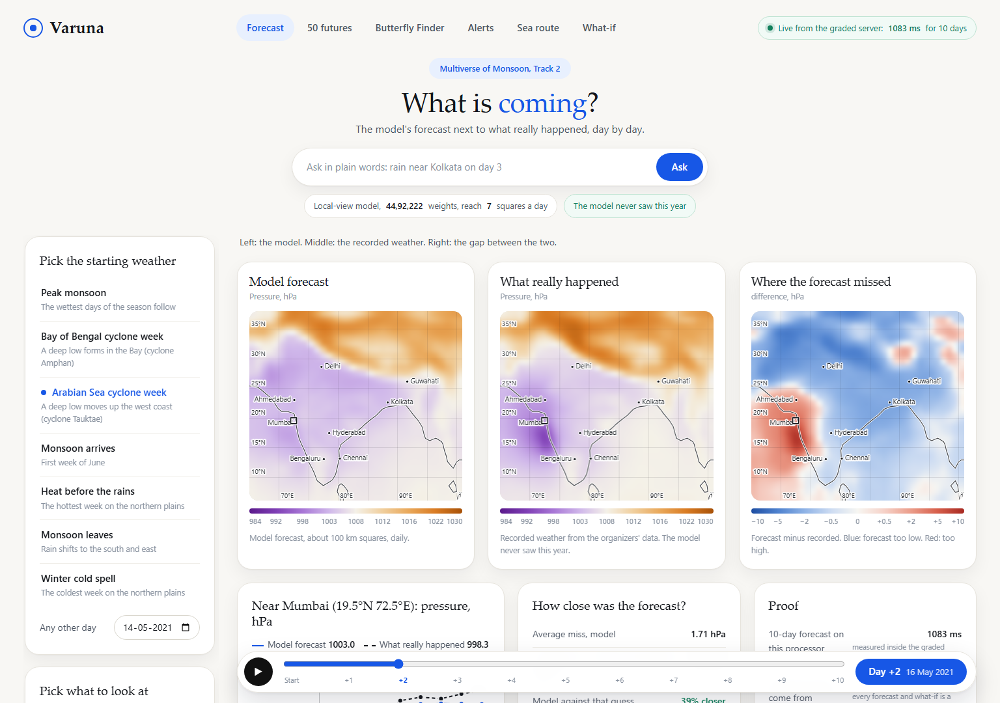
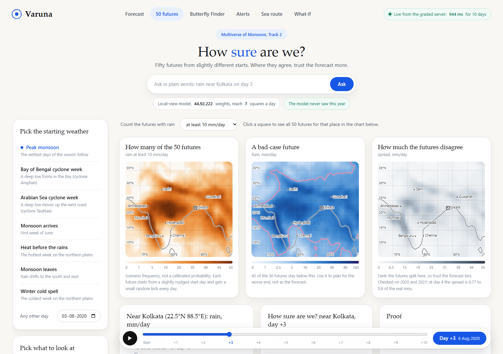
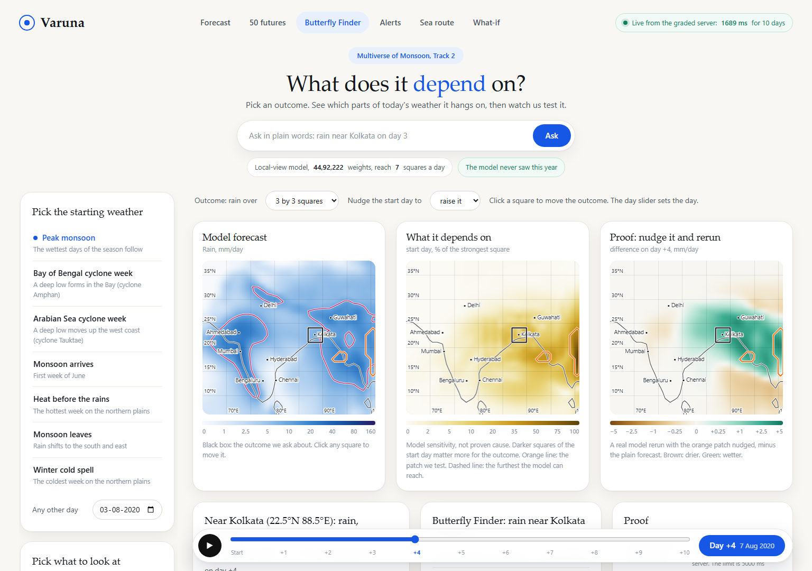
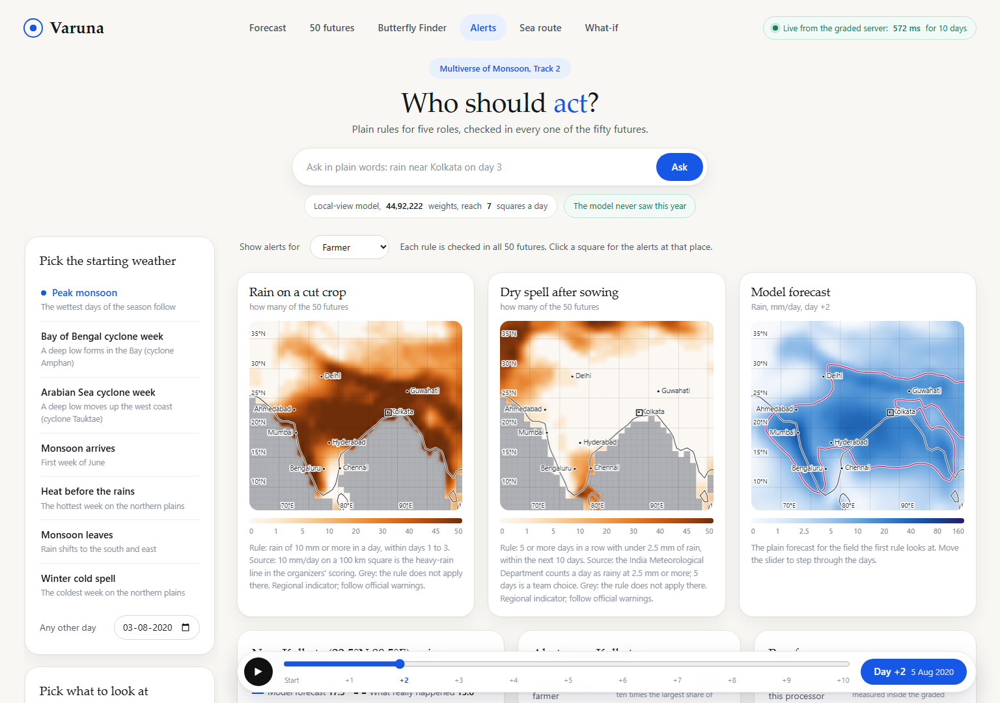
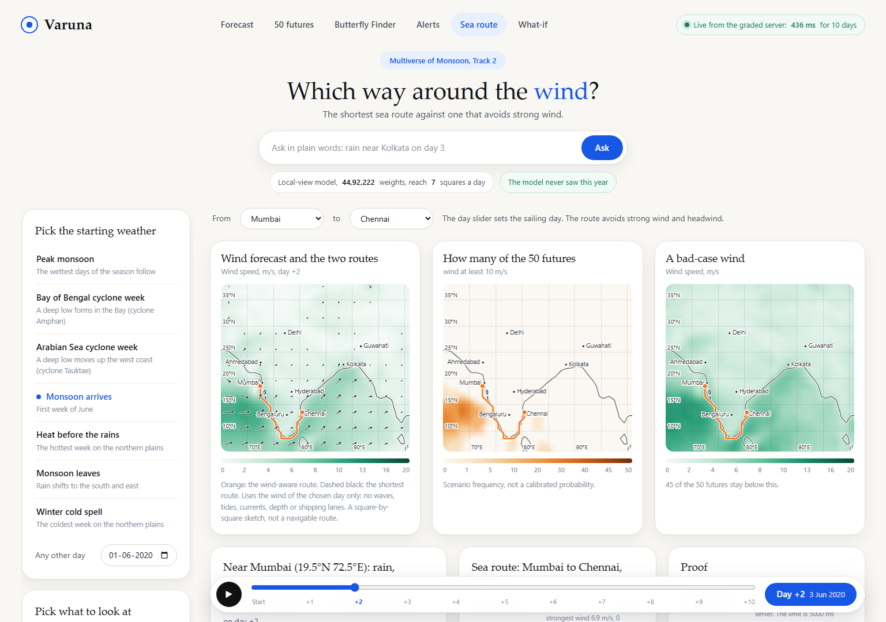
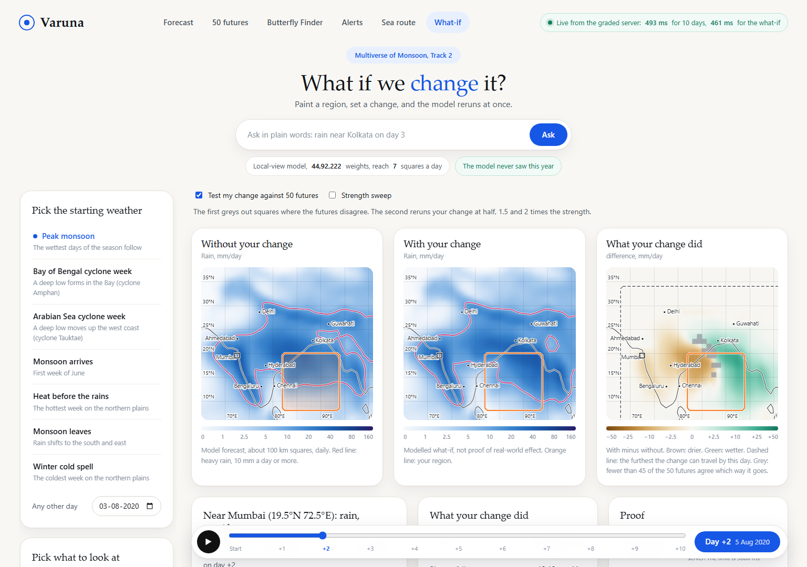

# VARUNA: Multiverse of Monsoon (Track 2)

Team Ship Happens. A small weather model for India that you can question: change the starting weather on a map and
watch what the model says happens next.

The 2-page brief is [`VARUNA_brief.pdf`](VARUNA_brief.pdf), at the top of this repo.



**To see the dashboard:** it is not hosted on the web. It runs on your own machine from this repo. Put the organizers'
data file in `data/`, start the two servers listed under "Run" below, and open http://127.0.0.1:8050.

## What it looks like

Every picture is the live dashboard running on the model in this repo. Start days are from 2020 and 2021, years the model never saw.

| | |
| --- | --- |
| **Temperature.** The hot week before the rains, forecast next to recorded weather.  | **Wind.** A cyclone week in the Bay of Bengal, with wind arrows.  |
| **Moisture.** The monsoon arriving in early June.  | **Pressure.** A deep low moving up the west coast.  |
| **50 futures.** How many of 50 runs bring heavy rain, a bad case, and where the runs split.  | **Butterfly Finder.** What rain near Kolkata on day 4 depends on, and the rerun that tests it.  |
| **Alerts.** Farmer rules checked in each of the 50 futures.  | **Sea route.** The shortest path against one that avoids strong wind.  |
| **What-if.** The official warm Bay of Bengal shock: without, with, and the difference.  | |

## What is in here

- **A forecast model.** It takes the last 3 days on a 32 by 36 grid and rolls forward day by day. It is five small
  networks averaged, 4.5 million weights and 17 MB in all, and takes about 0.4 s for 10 days on a laptop processor.
  No internet, no outside weather data.
- **The graded server.** `serve.py` with `POST /health` and `POST /simulate`, as the contract asks.
- **A dashboard.** One map, six tabs: Forecast, 50 futures, Butterfly Finder, Alerts, Sea route, What-if. Every forecast and
  what-if on it is a live call to the graded server's own route.

## Our own measurements

From `training/scoreboard.py`, which calls the organizers' scoring functions on 103 windows from 2020 and 2021. The
model never saw those years in training or tuning. The hidden test uses other dates, so the official numbers will differ.
The numbers are a little lower with normal weather built by the kit's own function (a 15-day window): 0.2 and 0.3
lower on the forecast and heavy-rain lines when we measured it on the single-network model.

| Part | Ours |
| --- | --- |
| Forecast error | 29.4 of 30 |
| Heavy rain | 8.0 of 15 |
| Sharpness | 10 of 10 |
| Shock tests | 12.8 of 15 |
| Model total | 60.2 of 70 |
| Repo scan on a clean clone | 15 of 15 |

## Setup

```
python -m venv .venv
.venv\Scripts\activate          (Linux or Mac: source .venv/bin/activate)
pip install -r requirements.txt
```

Put the organizers' file `india_climate_train.nc` in a folder named `data/`. It is never committed.

## Run

| What | Command | Then |
| --- | --- | --- |
| Graded server | `python serve.py --port 8000` | `POST /health` and `POST /simulate`, offline, CPU only |
| Dashboard | `python dashboard/backend.py` | open http://127.0.0.1:8050 (start the graded server first) |
| Train one network | `python training/train.py --epochs 14 12 0` | writes `model/varuna.pt` and `model/norm.npz` |
| Fit the fade | `python training/fit_fade.py` | writes the share of the forecast kept at each day ahead into `model/norm.npz` |
| Score the model | `python training/scoreboard.py --save dashboard/scores.json` | prints our estimate of the 70 model points |
| Check the 50 futures | `python training/calibrate_futures.py --years 2020 2021 --scales 1.0 --save dashboard/futures_check.json` | prints spread against real miss |

The graded server needs only what is in this repo. The dashboard also needs the data file, for its starting weather.
If the graded server is not running, the dashboard runs the same model itself and says so on screen.

The server averages every `model/varuna*.pt` it finds. The five in this repo were trained like this, each to its own
folder, then copied into `model/`:

```
python training/train.py --epochs 14 12 8                                              # varuna.pt (its best weights came from the 4-day stage)
python training/train.py --epochs 14 12 0 --seed 2 --out runs/b                         # varuna_b.pt
python training/train.py --epochs 14 12 0 --seed 3 --out runs/c                         # varuna_c.pt
python training/train.py --epochs 14 12 0 --seed 1 --width 128 --blocks 6 --batch 40 --out runs/d   # varuna_d.pt
python training/train.py --epochs 14 12 0 --seed 4 --width 128 --blocks 6 --batch 40 --out runs/e   # varuna_e.pt
```

Then `fit_fade.py`, then `scoreboard.py`. One standard network trains in about 7 minutes on a laptop graphics card, the
wider one in about 11. The scoreboard and the calibration script need the organizers' kit
(`pip install` the `yug-monsoon-kit` folder).

## How the model works, in short

- It predicts the gap from normal weather for the day of year, not the weather itself. The table of normal weather
  is built from 2005 to 2018 only.
- It sees only through 3 by 3 windows, at most seven per simulated day. So a change can travel at most 7 squares a
  day. No attention, no pooling, no map-wide normalisation.
- Five separately trained networks are averaged. Each is local, so the average is too. On 2020 and 2021 this added
  3.7 points over a single network. The set was chosen on 2019.
- It is trained on its own output for up to 4 days in a row, with a term in the loss that keeps maps sharp.
- From day 3 on, the server sends out only a share of the gap from normal (the fade), fitted on 2019.
- Data split: train 2005 to 2018, tune 2019, final check 2020 and 2021.

The brief has the full design, the measured results and the failure modes.

## The dashboard tabs

| Tab | Question | What it shows |
| --- | --- | --- |
| Forecast | What is coming? | The model next to what really happened, and the gap |
| 50 futures | How sure are we? | 50 runs from nudged starts: how many cross a line, a bad case, where they split |
| Butterfly Finder | What does it depend on? | Which squares of the start day an outcome depends on, tested with a real rerun |
| Alerts | Who should act? | Plain rules for five roles, checked in each of the 50 futures |
| Sea route | Which way around the wind? | The shortest path against a wind-aware path between two ports. Wind only: no waves, tides, depth or shipping lanes |
| What-if | What if I change it? | Paint a region, set a change, see with, without and the difference. Options: test against 50 futures, strength sweep |

Also on the page: a physics exam (12 live checks; fails are shown), a monsoon phase line on the Forecast tab, two extra
map fields (moisture flow, still air score), and an ask box that gives template answers from the numbers on screen.

Links can open a view directly, for example `http://127.0.0.1:8050/#tab=finder&day=4&field=tp&sel=16,23`.

## Layout

| Path | What it is |
| --- | --- |
| `serve.py` | The graded server. Two routes only. Imports only `model/`. |
| `model/` | The network code, five weight files, and a 365-day table of normal weather with the fade. |
| `training/` | Training, the fade fit, a local scoreboard that uses the organizers' scoring code, and the 50-futures check. |
| `dashboard/` | The map: `index.html`, `app.js`, `style.css`, and `backend.py` on its own port. `lab.py` holds the 50 futures and the Butterfly Finder, `alerts.py` the alert rules and their sources, `exam.py` the physics exam. |
| `VARUNA_brief.pdf` | The 2-page brief. Its source is `docs/brief.html`. |
| `SPEC.md` | The rules every teammate and AI tool follows. Read it before writing code. |

## What is simulated or chosen by us

- The 50 futures use random nudges and daily random kicks. The kick size is the model's own one-day miss, measured
  on 2019. Counts out of 50 are scenario frequencies, not calibrated probabilities.
- Alert thresholds are for 100 km daily squares. Each one is in `dashboard/alerts.py` with its source. Several are
  team choices and say so.
- The demo days in the dashboard are real days from the organizers' file, 2020 and 2021.
- No partner, agency or user has tested this. The use cases are our design, not a deployment.

## Honest limits

- One square is about 100 km and one step is one day. No cloudbursts, landslides or city floods.
- Past a week the forecast adds little over normal weather for the season.
- A what-if or a sensitivity map shows what the model does, not proof of what the real atmosphere would do.
- Scores above are from our own scoreboard. They are not the official grade.

## Built with

| Library | Used for | Licence |
| --- | --- | --- |
| PyTorch | the model, training, the server | BSD-3-Clause |
| NumPy | arrays | BSD-3-Clause |
| FastAPI | both servers | MIT |
| Uvicorn | both servers | BSD-3-Clause |
| xarray | reading the data file (training and dashboard only) | Apache-2.0 |
| netCDF4 | reading the data file (training and dashboard only) | MIT |
| yug-monsoon-kit | the organizers' scoring code, used by our scoreboard; not shipped here | the organizers' |

The dashboard page uses no libraries: plain JavaScript and canvas, no map tiles, no fonts from the web.

Everything in this repo was written during the event. AI coding assistants were used to write and review code and
for early idea notes.

## Data credit

The model was trained on `india_climate_train.nc` from the organizers' kit, and `model/norm.npz` holds a 365-day table
of normal weather worked out from it. That file contains modified Copernicus Climate Change Service information (ERA5,
Hersbach et al. 2020), accessed through Google WeatherBench 2 (Rasp et al. 2024). ERA5 is licensed under CC BY 4.0.
The organizers regridded it to 1 degree, daily values, on a 32 by 36 grid over 6.5N to 37.5N and 65.5E to 100.5E.
The data file itself is not in this repo.

## Method references

- Hakim and Masanam (2023), dynamical tests of a deep-learning weather model, arXiv:2309.10867. Idea of probing a
  learned model with local changes.
- Vonich and Hakim (2024), arXiv:2406.05019. Back-propagation through a learned forecast to find what an outcome
  depends on.
- Selz and Craig (2023), on whether AI weather models show the butterfly effect. The reason our 50 futures get a
  daily kick instead of only a nudged start.
